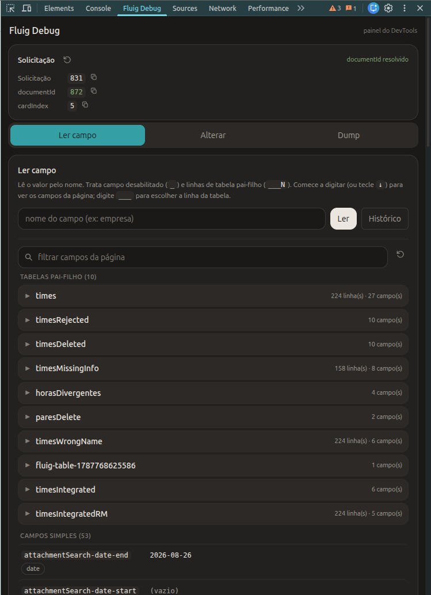

<br />
<div align="center">
  

  <h3>Fluig Debug - Extensão de DevTools para Formulários TOTVS Fluig</h3>

  <p>Inspecione, altere, localize e gere dumps estruturados de formulários Fluig diretamente no seu navegador, sem comandos manuais no console.</p>

  <p>
    <a href="#instalação"></a>
    <a href="#permissões"></a>
    <a href="#plataforma"></a>
    <a href="#versão"></a>
  </p>

  <br />
  
</div>

---

**Fluig Debug** é uma ferramenta de produtividade para desenvolvedores e consultores TOTVS Fluig. Integrada como uma aba nativa no Chrome/Edge DevTools (**F12**), ela elimina a necessidade de inspecionar frames manualmente, decifrar nomes espelhados no DOM ou colar scripts jQuery repetitivos no console.

A extensão é focada em velocidade, segurança e usabilidade: varre automaticamente iframes (`pageworkflowview`), normaliza prefixos (`_campo`) e sufixos (`campo___N`), identifica containers colapsados e gera dumps estruturados em JSON prontos para análise ou envio para IAs.

---

## 📑 Sumário

- [Visão Geral e Diferenciais ✨](#visão-geral-e-diferenciais-)
- [Instalação 📦](#instalação-)
- [Funcionalidades Principais 🚀](#funcionalidades-principais-)
  - [1. Contexto da Solicitação](#1-contexto-da-solicitação)
  - [2. Leitura e Localização de Campos (com Auto-Uncollapse)](#2-leitura-e-localização-de-campos-com-auto-uncollapse)
  - [3. Browser de Campos e Tabelas Pai-Filho](#3-browser-de-campos-e-tabelas-pai-filho)
  - [4. Alteração de Valores (DOM e Banco de Dados)](#4-alteração-de-valores-dom-e-banco-de-dados)
  - [5. Dump de Estado em JSON](#5-dump-de-estado-em-json)
  - [6. Histórico com Rollback](#6-histórico-com-rollback)
- [Arquitetura e Segurança 🛡️](#arquitetura-e-segurança-️)
- [Contribuindo 👩‍💻🧑‍💻](#contribuindo-)
- [Licença 📄](#licença-)

---

## Visão Geral e Diferenciais ✨

- **Zero Permissões no Manifest:** Não requer acesso a URLs, rede externa nem storage persistente. Executa de forma restrita e segura pelo DevTools.
- **Detecção Inteligente de Fluig:** A aba só é ativada em páginas que possuem o ecossistema Fluig (`WCMAPI` / `FLUIGC`), mantendo seu DevTools limpo em outros sites.
- **Suporte Total a iFrames:** Varre automaticamente o portal pai e os iframes internos do formulário.
- **Foco e Localização na Tela:** Encontra o elemento no formulário, abre sanfonas/painéis colapsados e rola a tela com destaque visual.

---

## Instalação 📦

### Opção 1: Instalação via Chrome Web Store (Recomendada)

Instale diretamente no seu navegador com atualizações automáticas:

<a href="https://chromewebstore.google.com/detail/glhffjhbcileloikpiiibpiddkddnelf?utm_source=item-share-cb">
  
</a>

---

### Opção 2: Instalação Manual (Modo Desenvolvedor)

Ideal para desenvolvimento local ou testes de novas branches:

```sh
# 1. Clone este repositório
git clone https://github.com/ryanpaulista/fluig-debug.git
```

1. Abra o navegador no endereço `chrome://extensions` (ou `edge://extensions`).
2. Ative o seletor **Modo do desenvolvedor** no canto superior direito.
3. Clique no botão **Carregar sem compactação** (*Load unpacked*).
4. Selecione a pasta **`extension/`** do projeto.

> **💡 Como recarregar após alterações locais:**
> 1. No card da extensão em `chrome://extensions`, clique no ícone **Recarregar (↻)**.
> 2. Feche e reabra o DevTools (**F12**) na página do Fluig.

---

## Funcionalidades Principais 🚀

### 1. Contexto da Solicitação
Exibe no topo fixo o número da **Solicitação de Workflow** e resolve automaticamente o **`documentId`** real consultando o dataset `workflowProcess` (sem depender de garimpo frágil no DOM).

### 2. Leitura e Localização de Campos (com Auto-Uncollapse)
- **Leitura instantânea:** Encontra o valor pelo nome lógico ou cru (`_campo`, `campo___1`, `span` somente leitura).
- **Localizar no formulário:** Clicando em **Localizar**, a extensão:
  1. Detecta se o campo está dentro de um painel Bootstrap ou Fluig colapsado (`.collapse`, `height: 0px`, `.tab-pane`, `<details>`) e o **descolapsa automaticamente**.
  2. Executa um scroll suave (*multi-pass*) garantindo que elementos no topo ou no rodapé fiquem visíveis.
  3. Aplica uma borda pulsante em teal (`#016a71`) ao redor do campo.

### 3. Browser de Campos e Tabelas Pai-Filho
Abaixo da barra de leitura, uma listagem inteligente indexa os campos da página:
- **Tabelas Pai-Filho no Topo:** Agrupadas em acordeões limpos com contagem de linhas e campos.
- **Exibição por Linhas (`___N`) ou por Colunas:** Alterne para inspecionar cada registro da tabela individualmente ou ver um resumo estrutural das colunas.
- **Filtro em Tempo Real:** Pesquisa simultânea por nome do campo, tabela ou valor preenchido.
- **Atalhos Rápidos:** Botões inline para **Ler**, **Setar** e **Copiar** o nome de qualquer campo.

### 4. Alteração de Valores (DOM e Banco de Dados)
- **Setar via DOM:** Aplica `$(campo).val(novoValor)` com tela prévia de confirmação e *read-back* do valor persistido.
- **Setar no Banco (`dsSetCardValue`):** Permite gravar valores diretamente no banco através de dataset customizado para formulários finalizados ou campos bloqueados.
  > **⚠️ Requisito para Gravação no Banco:** Para que a funcionalidade de gravar no banco funcione, o ambiente Fluig deve possuir um dataset customizado chamado **`dsSetCardValue`** cadastrado no servidor. Ele recebe as constraints `documentid`, `fieldName` e `fieldValue` para persistência via API interna.

### 5. Dump de Estado em JSON
Coleta o estado completo do formulário com um clique:
- **JSON Agrupado:** Metadados, campos simples, tabelas pai-filho estruturadas por linha e logs de console capturados.
- **Pronto para IAs:** Formato otimizado para copiar com um clique e colar em chats de IA (como Gemini ou ChatGPT) para diagnóstico ágil de bugs.

### 6. Histórico com Rollback
Histórico de ações (Ler, Setar e Setar no Banco) com botão de **Restaurar valor anterior**, permitindo desfazer alterações acidentais em segundos.

---

## Arquitetura e Segurança 🛡️

```
extension/
├── manifest.json     # Manifest V3 — zero permissões requisitadas
├── devtools.html     # Página oculta do DevTools que orquestra o ciclo de vida
├── devtools.js       # Detecção de ambiente Fluig e registro da aba no DevTools
├── panel.html        # Marcação da interface (abas e componentes)
├── css/
│   └── panel.css     # Estilos (tokens de design e componentes)
└── js/               # Lógica do painel, dividida por responsabilidade
    ├── bridge.js           # Ponte inspectedWindow.eval + helpers injetados na página
    ├── page-find.js        # Expressões de página: localizar campo, focar, coletar linha
    ├── page-index.js       # Expressão de página: índice de campos (autocomplete)
    ├── page-set.js         # Expressão de página: setar valor no DOM
    ├── ui-utils.js         # Render, copiar, escape e tags
    ├── textarea-history.js # Undo / Redo / Revert de textareas
    ├── history.js          # Histórico por seção
    ├── autocomplete.js     # Autocomplete de nome de campo
    ├── history-actions.js  # Registro e ações (restaurar / reler) do histórico
    ├── read.js · set.js    # Aba Campos: ler e setar no DOM
    ├── dump.js             # Aba Dump: dump JSON
    ├── field-browser.js    # Browser de campos e tabelas pai-filho
    ├── solicitacao.js      # documentId da solicitação e helpers de dataset
    ├── dbset.js            # Setar campo direto no banco
    ├── tabs.js             # Troca de abas
    ├── wiring-read.js      # Eventos: leitura e histórico
    ├── wiring-browser.js   # Eventos: browser de campos
    └── main.js             # Eventos globais e inicialização
```

> **ℹ️ Ordem de carga:** os arquivos de `js/` são scripts clássicos que compartilham o escopo global (sem bundler nem build). A ordem das tags `<script>` em `panel.html` é significativa: `bridge.js` e `page-*.js` primeiro, `main.js` por último. Ao criar um novo módulo, registre-o em `panel.html` respeitando essa ordem.

- **Sem dependências externas:** Construído em JavaScript puro, leve e sem frameworks pesados.
- **CSP Compliant (MV3):** Nenhuma injeção de script inline; total conformidade com as diretrizes do Manifest V3.
- **Isolamento e Privacidade:** Dados e históricos residem exclusivamente na memória volátil da sessão do DevTools e não são persistidos nem transmitidos externamente.

---

## Contribuindo 👩‍💻

Contribuições são muito bem-vindas! Para manter a qualidade e estabilidade da extensão:

1. **Abra uma Issue:** Antes de iniciar uma grande alteração, abra uma [Issue](https://github.com/ryanpaulista/fluig-debug/issues) para discutir a proposta ou reportar bugs.
2. **Crie uma Branch:** Crie uma branch para sua funcionalidade (`git checkout -b feature/minha-melhoria`).
3. **Submeta um Pull Request:** Envie suas alterações via **Pull Request**.
4. **Revisão:** Todos os PRs passam por revisão e aprovação antes de serem mesclados na branch principal.

---

## Licença 📄

Distribuído sob a licença [MIT](LICENSE).


